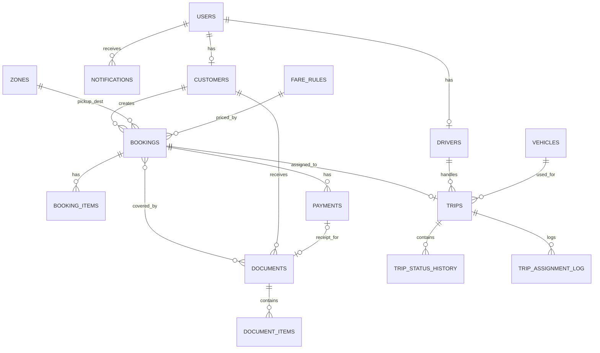

# DilaDrive – Final Decisions & ERD v2
Version 0.2 · 18 Oct 2026 · **Supersedes** §3.6, §3.7, §5.2 (driver dashboard), §6.2–6.5 and §7 of `DILADRIVE_BLUEPRINT.md`. Everything else in the blueprint stays.

---

## 1. Locked Decisions

| # | Topic | Decision |
|---|-------|----------|
| D1 | Design | Maroon + cream + white cards (tokens in blueprint §4) |
| D2 | Flutter | **One app**, role-based login. Role in JWT decides home: `DRIVER` → driver shell, `CUSTOMER` → customer shell. Admin uses web only (admin login on mobile is rejected). |
| D3 | Real-time | Polling (10–15 s on active screens: admin live-trips, customer trip tracker, driver current trip) + pull-to-refresh. Notifications list polled every 30 s. FCM = future upgrade. |
| D4 | Fare | **Hybrid, admin-final** – see §2. |
| D5 | Booking approval | Customer booking is always `PENDING`; only admin approval makes it `CONFIRMED`. |
| D6 | Driver dashboard | **No earnings/commission.** Shows today's active trip, upcoming jobs, completed-trip count. |
| D7 | Buffer time | Default **30 min**, editable in Settings (`system_settings.buffer_minutes`). |
| D8 | Cancellation | Customer can self-cancel up to **24 h** before pickup (editable `cancel_cutoff_hours`). Inside the window the app shows "Contact admin" and the customer can submit a cancel request (booking stays active until admin cancels). Admin can cancel any time with a reason. |
| D9 | Language | English only |

> D7/D8 are sensible defaults because the owner has no fixed rule today. Confirm with Mrs. Fadilah during UAT; they are settings, not code, so changing them is cheap.

---

## 2. Fare Logic (D4)

**Why hybrid:** real quotations show *fixed* prices for common airport/school runs (RM130 / 180 / 200) but custom routes need a distance-based price. Owner also negotiates, so the system **suggests**, admin **finalizes**.

```
calculateFare(booking):
  1. FIXED_ROUTE: find active fare_rule where
       origin_zone = booking.pickup_zone AND destination_zone = booking.destination_zone
       AND vehicle_type = booking.vehicle_type
     → fare = rule.fixed_price
  2. else PER_KM: rule for vehicle_type
     → fare = max(min_fare, base_fare + rate_per_km × estimated_distance_km)
  3. trip_type = TWO_WAY → fare × 2 (multiplier in settings)
  4. calculated_fare = fare
  5. Admin may override → final_fare (default = calculated_fare)
  6. Extras (pager, waiting time, etc.) = booking_items (EXTRA_CHARGE)
  7. Credit-card payment → +6% surcharge item (settings: card_surcharge_percent)
```
- **Distance source:** `DistanceService` interface. v1 implementation = routing API (OpenRouteService or OSRM, free tier) called once at booking time; if it fails, admin types distance manually. This is *route distance estimation*, not GPS tracking, so it stays within thesis scope (no third-party GPS tracking apps).
- Customer sees **"Estimated fare"**; confirmed price is shown after admin approval.
- Falls back gracefully: no rule found + no distance → fare = null, booking still allowed, admin must set `final_fare` before approving.

**Ask Mrs. Fadilah for (to seed `fare_rules`):** price list per route (KLIA1/KLIA2 ↔ main areas, school runs), per vehicle type (sedan/MPV/van), and per-km rate + minimum fare for other trips.

---

## 3. ERD v2

### 3.1 Diagram


### 3.2 Enums (PostgreSQL `CREATE TYPE` or `varchar` + CHECK; Java enums mirror these)
```
role_t              ADMIN | DRIVER | CUSTOMER
account_status_t    PENDING | ACTIVE | SUSPENDED
customer_type_t     INDIVIDUAL | CORPORATE
verify_status_t     UNVERIFIED | VERIFIED | REJECTED
driver_type_t       OWNER | ASSOCIATE
driver_avail_t      AVAILABLE | ON_TRIP | OFF_DUTY
vehicle_type_t      SEDAN | MPV | VAN | LIMO
vehicle_status_t    AVAILABLE | IN_USE | MAINTENANCE | INACTIVE
trip_type_t         ONE_WAY | TWO_WAY
fare_rule_type_t    FIXED_ROUTE | PER_KM
booking_status_t    PENDING | CONFIRMED | ASSIGNED | IN_PROGRESS | COMPLETED | REJECTED | CANCELLED
booking_pay_t       UNPAID | PARTIAL | PAID            (derived from verified payments vs final_fare)
item_type_t         BASE_FARE | EXTRA_CHARGE | SURCHARGE | DISCOUNT
trip_status_t       ASSIGNED | ARRIVED_PICKUP | PASSENGER_ONBOARD | EN_ROUTE | ARRIVED_DROPOFF | COMPLETED | CANCELLED
payment_method_t    CASH | BANK_TRANSFER | WISE | CREDIT_CARD
payment_status_t    PENDING_VERIFICATION | VERIFIED | REJECTED
document_type_t    QUOTATION | INVOICE | RECEIPT
document_status_t   DRAFT | ISSUED | VOID
notification_type_t BOOKING_APPROVED | BOOKING_REJECTED | DRIVER_ASSIGNED | TRIP_REASSIGNED | TRIP_UPDATE
                    | PAYMENT_VERIFIED | PAYMENT_REJECTED | DOCUMENT_READY | REMINDER | CANCEL_REQUEST
```

### 3.3 Tables
Conventions: `bigint` identity PK, `timestamptz` for date-times, `numeric(10,2)` for money, `created_at/updated_at` on every table (omitted below for brevity). **Bold** = new or changed vs ERD v1.

**users**
| column | type | notes |
|---|---|---|
| user_id | PK | |
| full_name | varchar(100) | |
| phone_no | varchar(20) | |
| email | varchar(100) | unique |
| username | varchar(50) | unique |
| **password_hash** | varchar(255) | BCrypt (was `password`) |
| role | role_t | |
| account_status | account_status_t | |

**customers**
| column | type | notes |
|---|---|---|
| customer_id | PK | |
| user_id | FK → users, unique | |
| customer_type | customer_type_t | |
| verification_status | verify_status_t | |
| **company_name** | varchar(150) | corporate only |
| **supplier_no** | varchar(50) | e.g. FP8587 |
| **contact_person** | varchar(100) | "Attn: Ms. Su Li" |
| **billing_address** | text | printed on documents |
| **verified_by / verified_at** | FK users / timestamptz | |

**drivers**
| column | type | notes |
|---|---|---|
| driver_id | PK | |
| user_id | FK → users, unique | |
| **driver_type** | driver_type_t | OWNER / ASSOCIATE |
| license_no | varchar(30) | |
| license_expiry | date | expired → cannot be assigned |
| availability_status | driver_avail_t | |

**vehicles**
| column | type | notes |
|---|---|---|
| vehicle_id | PK | |
| plate_number | varchar(15) | unique |
| vehicle_model | varchar(80) | |
| **vehicle_type** | vehicle_type_t | |
| seating_capacity / luggage_capacity | int | |
| road_tax_expiry / service_expiry | date | expired → cannot be assigned |
| vehicle_status | vehicle_status_t | |

**zones** *(new)*: `zone_id` PK, `name` (e.g. KLIA 1, KLIA 2, KL Sentral, Bandar Utama, OTHER), `is_active`.

**fare_rules** *(new)*
| column | type | notes |
|---|---|---|
| fare_rule_id | PK | |
| rule_type | fare_rule_type_t | |
| vehicle_type | vehicle_type_t | |
| origin_zone_id / destination_zone_id | FK → zones, nullable | FIXED_ROUTE only |
| fixed_price | numeric(10,2) | FIXED_ROUTE |
| base_fare / rate_per_km / min_fare | numeric(10,2) | PER_KM |
| is_active | boolean | |

**system_settings** *(new)*: `key` PK, `value`, `description`. Seed: `buffer_minutes=30`, `cancel_cutoff_hours=24`, `card_surcharge_percent=6`, `two_way_multiplier=2`, `company_name`, `company_reg_no=TR0242559-U`, `bank_account`, `sst_percent=0`.

**bookings**
| column | type | notes |
|---|---|---|
| booking_id | PK | |
| **booking_no** | varchar(20) unique | `DD-2610-0001` |
| customer_id | FK | |
| pickup_location / destination | text | free-text address |
| **pickup_zone_id / destination_zone_id** | FK → zones | drives fixed-route pricing |
| pickup_datetime | timestamptz | |
| passenger_count / luggage_count | int | validated vs vehicle capacity |
| flight_number | varchar(20) | |
| **vehicle_type** | vehicle_type_t | requested type |
| **trip_type** | trip_type_t | |
| **po_number** | varchar(50) | corporate PO |
| **special_request** | text | |
| **estimated_distance_km / estimated_duration_min** | numeric / int | duration used for conflict window |
| **fare_rule_id** | FK, nullable | rule used |
| **calculated_fare / final_fare** | numeric(10,2) | system suggestion / admin-confirmed |
| booking_status | booking_status_t | |
| **payment_status** | booking_pay_t | derived |
| **rejection_reason / cancel_reason** | text | |
| **verified_by / verified_at** | FK users / timestamptz | |

**booking_items** *(new – supports multi-line invoices)*: `item_id` PK, `booking_id` FK, `item_type`, `description` (e.g. "KLIA2 → Sri Bestari School", "Pager"), `quantity`, `unit_price`, `amount`.

**trips**
| column | type | notes |
|---|---|---|
| trip_id | PK | |
| booking_id | FK, **unique** | 1 booking : 1 trip (v1) |
| driver_id / vehicle_id | FK | |
| trip_status | trip_status_t | |
| assigned_date | timestamptz | |
| **assigned_by** | FK users | |
| **scheduled_start / scheduled_end** | timestamptz | start = pickup_datetime, end = start + duration; used by conflict query |
| **started_at / completed_at** | timestamptz | |

Index: `(driver_id, scheduled_start, scheduled_end)` and `(vehicle_id, scheduled_start, scheduled_end)`.

**trip_status_history**: `status_id` PK, `trip_id` FK, `status` trip_status_t, `update_time`, **`updated_by`** FK users, **`note`**.

**trip_assignment_log** *(new – audit for Reassign Trip)*: `log_id` PK, `trip_id` FK, `driver_id`, `vehicle_id`, `assigned_by`, `assigned_at`, `unassigned_at`, `reason`.

**payments** *(1 booking : N payments — a rejected receipt is re-uploaded as a new row; deposits possible)*
| column | type | notes |
|---|---|---|
| payment_id | PK | |
| booking_id | FK | |
| **amount** | numeric(10,2) | |
| **payment_method** | payment_method_t | |
| **surcharge_amount** | numeric(10,2) | card +6% |
| receipt_file | varchar(255) | path |
| **payment_status** | payment_status_t | |
| **reject_reason** | text | |
| upload_date / verification_date | timestamptz | |
| **verified_by** | FK users | |

**documents**
| column | type | notes |
|---|---|---|
| document_id | PK | |
| **document_no** | varchar(30) unique | `QTN-0021`, `INV-0018`, `RCP-1564` |
| document_type | document_type_t | |
| **customer_id** | FK | |
| **payment_id** | FK, nullable | receipts only |
| **po_number** | varchar(50) | printed on invoice |
| **subtotal / tax_amount / total_amount** | numeric(10,2) | |
| **issue_date / due_date** | date | |
| **document_status** | document_status_t | |
| **version** | int | increments on Update Document (regenerate); old PDF kept |
| document_file | varchar(255) | PDF path |
| generated_date / **generated_by** | timestamptz / FK users | |

**document_bookings** *(new, M:N)*: `document_id`, `booking_id` — lets one corporate invoice cover many bookings/days (Cambridge example).

**document_items** *(new – snapshot of invoice lines at generation time so later booking edits never silently change an issued document)*: `doc_item_id` PK, `document_id` FK, `booking_id` FK, `description`, `amount`, `sort_order`.

**document_sequences** *(new)*: `document_type` PK, `prefix`, `last_number`. Increment inside the generating transaction (`SELECT … FOR UPDATE`) to avoid duplicate numbers.

**notifications**: `notification_id` PK, `user_id` FK, **`booking_id` FK nullable**, `notification_type`, **`title`**, `notification_message`, **`is_read`**, `sent_datetime`.

---

## 4. Updated Rules

### 4.1 Booking states (D5)
```
PENDING ──approve──► CONFIRMED ──assign──► ASSIGNED ──first milestone──► IN_PROGRESS ──► COMPLETED
   │                                                                 
   ├──reject (reason)──► REJECTED
   └──cancel (customer within cutoff / admin any time)──► CANCELLED
```
- Admin **approve** requires `final_fare` set. Approval triggers notification (use case *Verify Booking → Send notification*).
- Customer may edit booking only while `PENDING`; after that → "Contact admin" / admin edits.

### 4.2 Assignment validation (include *Check Driver Availability*)
Reject assignment if any of:
- driver/vehicle has a non-cancelled, non-completed trip overlapping `[scheduled_start − buffer, scheduled_end + buffer]`
- driver `license_expiry` < trip date, or vehicle `road_tax_expiry` / `service_expiry` < trip date
- vehicle status `MAINTENANCE` / `INACTIVE`
- `passenger_count > seating_capacity` or `luggage_count > luggage_capacity`
Run inside one transaction with `SELECT … FOR UPDATE` on driver and vehicle rows.

### 4.3 Payment & documents
- Booking `payment_status` = `PAID` when sum(VERIFIED payments, excluding surcharge) ≥ `final_fare`; `PARTIAL` if > 0; else `UNPAID`.
- Verifying a payment auto-generates the **Receipt** (document_type RECEIPT, `payment_id` set) and notifies customer.
- **Quotation** can be generated once booking is `CONFIRMED`; **Invoice** after trip `COMPLETED` (can bundle several completed bookings of the same corporate customer).
- *Update Document* → edit lines → regenerate → `version + 1`; previous version marked `VOID` but kept for audit.
- Customer can download only documents where `documents.customer_id` = own customer_id and `document_status = ISSUED`.

### 4.4 Driver dashboard (D6)
```
Dashboard:  Today's active trip card  ·  Upcoming jobs (next 7 days, sorted)  ·  Total completed trips
Schedule:   calendar/list of assigned trips
Current Trip: client details + milestone stepper (big button: "Arrived at Pick-up" → "Passenger Onboard" → "En Route" → "Arrived at Drop-off" → "Complete Trip")
Trip History
```
Milestones must be updated in order (cannot skip). Each press writes `trip_status_history` and updates `trips.trip_status`; first milestone also sets booking `IN_PROGRESS`.

---

## 5. Remaining Items (non-blocking)
1. Price list from Mrs. Fadilah → seed `fare_rules` (needed before fare testing; use placeholder prices until then).
2. Confirm D7/D8 defaults during UAT.
3. Logo + bank details for document templates.
4. Hosting target for demo.

## 6. Next Step
Create monorepo skeleton → Flyway `V1__init_schema.sql` from §3 → seed data (admin user, sample vehicles/drivers/zones/fare rules/settings) → Spring Boot project with auth. Say "start" and I'll generate the repo structure and the migration SQL.
