# DilaDrive database audit

**Audit date** 25 November 2026, Asia/Kuala_Lumpur  
**Scope** Local PostgreSQL 18 `DilaDrive.public`, the checked-out Spring Boot, Admin React and Flutter sources, documentation and numbered SQL migrations. The checkout may differ from a deployed build.

## A. Database summary

| Classification | Tables |
| --- | ---: |
| Existing physical tables | 30 |
| Active | 15 |
| Indirectly used | 6 |
| Partially implemented | 2 |
| Unused | 0 |
| Redundant | 0 |
| Legacy | 7 |
| Unverified | 0 |
| Required but missing, outside the existing total | 2 |

Seven tables are **unused by current application code** and classified **Legacy** because all contain historical rows. Several overlap with live functionality. None was proven to be an exact redundant copy or safe to remove immediately. Production jobs, integrations, database backups and files referenced by historical proof records were outside the local inspection.

The audit queried the live catalog with `default_transaction_read_only=on` and verified `transaction_read_only = on`. It gathered exact counts, columns, defaults, PKs, FKs, checks, indexes, views and trigger definitions, then counted relationship anomalies without returning personal data, tokens, credentials, or document contents. Static checks covered entity mappings, JPQL and native SQL, direct JDBC, controller routes, API clients, screens, scheduled tasks and migration sources. No application startup or state-changing statements were needed. There were no public views, materialized views, or current Hibernate-generated junction mappings in the inspected source. Two deferred driver/vehicle constraint triggers and one fare-category trigger are live. No orphan rows were found across the 51 declared foreign keys. Absence of an orphan cannot establish that missing constraints are safe.

## B. Table usage analysis

Backend entries distinguish repository-backed operations from JDBC and nonuse. Rows, primary keys, exact foreign-key columns and inventory appear in the schema section and live key register.

| Table Name | Purpose | Backend Usage | Frontend Usage | Related Use Case | Dependencies | Classification | Recommendation | Evidence |
| --- | --- | --- | --- | --- | --- | --- | --- | --- |
| `admin` | Admin account, authorization and reviewer identity | Admin/Auth controllers → AdminService/AdminRepository, R/W | Admin management, login, profile | Create/View/Update Account; Super Admin creates Admin | None declared | **ACTIVE** | Keep | [AdminManagementService.java:51](../backend/diladrive-api/src/main/java/com/diladrive/service/AdminManagementService.java#L51) |
| `assignment` | Earlier allocation table | No production SQL or ORM mapping. JPQL Assignment maps to driver_assignment | None found | Historical Assign Driver & Vehicle | booking_id → booking; driver_id → driver; vehicle_id → vehicle | **LEGACY** | Preserve and reconcile before archive review | [Assignment.java:8](../backend/diladrive-api/src/main/java/com/diladrive/entity/Assignment.java#L8), [AssignmentRepository.java:120](../backend/diladrive-api/src/main/java/com/diladrive/repository/AssignmentRepository.java#L120) |
| `assignment_verification_photo` | Pickup/drop proof metadata attached to a live assignment | AssignmentController photos → VerificationPhotoService/VerificationPhotoRepository, R/W | Driver proof upload; Admin assignment photos | Upload/View Proof of Service | assignment_id → driver_assignment | **ACTIVE** | Keep | [VerificationPhoto.java:7](../backend/diladrive-api/src/main/java/com/diladrive/entity/VerificationPhoto.java#L7) |
| `booking` | Scheduled customer contract and accepted fare | BookingController → CustomerTripService/BookingService/BookingRepository, R/W | Admin Bookings; Flutter booking and My Bookings | Create/View/Update/Cancel/Verify Booking | driver_id → driver; vehicle_id → vehicle; cust_id → customer; road_distance_confirmed_by → admin; preferred_vehicle_id → vehicle | **ACTIVE** | Keep | [Booking.java:10](../backend/diladrive-api/src/main/java/com/diladrive/entity/Booking.java#L10), [AssignmentRepository.java:110](../backend/diladrive-api/src/main/java/com/diladrive/repository/AssignmentRepository.java#L110), [BookingRepository.java:42](../backend/diladrive-api/src/main/java/com/diladrive/repository/BookingRepository.java#L42) |
| `booking_fare_rate` | Optional category-specific pricing rates | PricingController → PricingService, JDBC R/W | Admin Settings; customer fare estimates | View/Update Pricing; Estimated Price | None declared | **ACTIVE** | Keep | [PricingService.java:68](../backend/diladrive-api/src/main/java/com/diladrive/service/PricingService.java#L68) |
| `booking_fare_revision` | Explicit fare proposal and accepted-fare history | BookingPriceController → BookingPriceService, JDBC R/W; CustomerTripService appends edits | Admin FareProposalPanel; customer booking fare review | Update Booking; Verify Booking; Fare acceptance | booking_id → booking; proposed_by → admin | **ACTIVE** | Keep | [BookingPriceService.java:74](../backend/diladrive-api/src/main/java/com/diladrive/service/BookingPriceService.java#L74), [CustomerTripService.java:526](../backend/diladrive-api/src/main/java/com/diladrive/service/CustomerTripService.java#L526) |
| `booking_pickup_alert` | Deduplicate Admin pickup warnings | BookingPickupCheck scheduled JDBC reads bookings and inserts marker | Indirect via Admin inbox | Availability monitoring | booking_id → booking | **INDIRECTLY USED** | Keep | [BookingPickupCheck.java:68](../backend/diladrive-api/src/main/java/com/diladrive/service/BookingPickupCheck.java#L68) |
| `booking_request_idempotency` | Deduplicate booking submissions and replay result | BookingController customer submission → CustomerTripService → BookingRequestIdempotencyRepository, insert/lock/read/update | Flutter submission sends Idempotency-Key | Create Booking | customer_id → customer | **INDIRECTLY USED** | Keep | [BookingRequestIdempotency.java:7](../backend/diladrive-api/src/main/java/com/diladrive/entity/BookingRequestIdempotency.java#L7), [BookingRequestIdempotencyRepository.java:17](../backend/diladrive-api/src/main/java/com/diladrive/repository/BookingRequestIdempotencyRepository.java#L17) |
| `booking_vehicle_hold` | Temporary schedule reservation before Admin confirmation | CustomerTripService, AssignmentServiceImpl, BookingPriceService, JDBC R/W and expiry | Customer submission; Admin preview/change; resource schedule | Create/Verify/Cancel Booking; Calendar Conflict Detection | booking_id → booking; vehicle_id → vehicle; driver_id → driver | **INDIRECTLY USED** | Keep | [BookingPriceService.java:68](../backend/diladrive-api/src/main/java/com/diladrive/service/BookingPriceService.java#L68), [CustomerTripService.java:402](../backend/diladrive-api/src/main/java/com/diladrive/service/CustomerTripService.java#L402) |
| `customer` | Normal/corporate account and verification state | Auth/Customer controllers → CustomerService/CustomerRepository, R/W | Admin Customers; Flutter register, login and account | Create/View/Update/Verify Account; Corporate Customer | verified_by_admin_id → admin | **ACTIVE** | Keep | [Customer.java:10](../backend/diladrive-api/src/main/java/com/diladrive/entity/Customer.java#L10), [AssignmentRepository.java:111](../backend/diladrive-api/src/main/java/com/diladrive/repository/AssignmentRepository.java#L111), [CustomerRepository.java:18](../backend/diladrive-api/src/main/java/com/diladrive/repository/CustomerRepository.java#L18) |
| `customer_verification_history` | Customer review decision ledger | CustomerController /verification → CustomerVerificationService, JDBC append | Admin Customers approval/rejection produces entries | Verify Account | customer_id → customer; admin_id → admin | **INDIRECTLY USED** | Keep | [CustomerVerificationService.java:59](../backend/diladrive-api/src/main/java/com/diladrive/service/CustomerVerificationService.java#L59), [Customers.jsx:221](../web-admin/src/pages/Customers.jsx#L221) |
| `documents` | Typed quotation, purchase order, invoice and receipt ledger | DocumentController → DocumentServiceImpl/DocumentRepository, R/W; PDF rendering reads | Admin Documents; Customer Business Documents | Generate/View/Update Quotation; PO; Generate/View Invoice/Receipt | payment_id → payment; booking_id → booking; cust_id → customer | **ACTIVE** | Keep | [DocumentServiceImpl.java:188](../backend/diladrive-api/src/main/java/com/diladrive/service/DocumentServiceImpl.java#L188), [DocumentPdfService.java:40](../backend/diladrive-api/src/main/java/com/diladrive/service/DocumentPdfService.java#L40), [Documents.jsx:24](../web-admin/src/pages/Documents.jsx#L24) |
| `driver` | Driver account and operational availability | Driver/Auth controllers → DriverService/DriverRepository, R/W | Admin Drivers; Driver account | Admin creates driver; View/Update Account | None declared | **ACTIVE** | Keep | [Driver.java:7](../backend/diladrive-api/src/main/java/com/diladrive/entity/Driver.java#L7), [AssignmentRepository.java:112](../backend/diladrive-api/src/main/java/com/diladrive/repository/AssignmentRepository.java#L112), [DriverRepository.java:26](../backend/diladrive-api/src/main/java/com/diladrive/repository/DriverRepository.java#L26) |
| `driver_assignment` | Allocation, current milestone and superseded history | AssignmentController and BookingConfirmationController → AssignmentServiceImpl/AssignmentRepository, R/W | Admin Bookings/Assignments; Driver Trips; Customer My Bookings | Assign/Reassign; View Trip; Update Trip Status | booking_id → booking; driver_id → driver; vehicle_id → vehicle; previous_assignment_id → driver_assignment | **ACTIVE** | Keep | [Assignment.java:8](../backend/diladrive-api/src/main/java/com/diladrive/entity/Assignment.java#L8), [AssignmentRepository.java:109](../backend/diladrive-api/src/main/java/com/diladrive/repository/AssignmentRepository.java#L109), [BookingPickupCheck.java:50](../backend/diladrive-api/src/main/java/com/diladrive/service/BookingPickupCheck.java#L50) |
| `driver_commission_audit` | Commission payment-state audit trail | TripFinanceController /driver-earnings/{assignmentId}/history → TripFinanceService, JDBC R/W | Supports Admin Driver Earnings history endpoint | View Commission; commission audit | assignment_id → driver_trip_commission; admin_id → admin | **INDIRECTLY USED** | Keep | [TripFinanceService.java:336](../backend/diladrive-api/src/main/java/com/diladrive/service/TripFinanceService.java#L336) |
| `driver_trip_commission` | One earning snapshot per completed booking | TripFinanceController/AssignmentServiceImpl → TripFinanceService, JDBC R/W | Admin Driver Earnings | View Commission; complete trip; settle commission | driver_id → driver; paid_by → admin; assignment_id → driver_assignment; booking_id → booking | **ACTIVE** | Keep | [TripFinanceService.java:317](../backend/diladrive-api/src/main/java/com/diladrive/service/TripFinanceService.java#L317) |
| `driver_unavailable_period` | Planned driver blackout intervals | CustomerTripService schedule/conflict checks, JDBC read; no application writer found | Admin driver schedule displays rows | Calendar Conflict Detection; driver availability | driver_id → driver | **PARTIALLY IMPLEMENTED** | Keep and define authorized management | [CustomerTripService.java:384](../backend/diladrive-api/src/main/java/com/diladrive/service/CustomerTripService.java#L384) |
| `invoice` | Earlier standalone invoice | Current invoices and finance SQL read documents | None for this table | Historical Invoice | booking_id → booking | **LEGACY** | Preserve and reconcile before archive review | [001_diladrive_schema.sql:116](../database/schema/001_diladrive_schema.sql#L116) |
| `mobile_push_token` | FCM registration and routing by role plus recipient ID | Mobile push-token controller → BookingPushService, JDBC upsert/read/delete | Flutter push registration/unregistration | Firebase Push Notification | None declared | **INDIRECTLY USED** | Keep | [BookingPushService.java:63](../backend/diladrive-api/src/main/java/com/diladrive/service/BookingPushService.java#L63) |
| `notification` | Role-owned inbox and read state | NotificationController → NotificationService/NotificationRepository, R/W | Admin, Customer and Driver notification inboxes | Notification Inbox | driver_id → driver | **ACTIVE** | Keep | [Notification.java:8](../backend/diladrive-api/src/main/java/com/diladrive/entity/Notification.java#L8), [NotificationRepository.java:24](../backend/diladrive-api/src/main/java/com/diladrive/repository/NotificationRepository.java#L24) |
| `payment` | Manual cash and transfer proof/review ledger | PaymentController → PaymentService/PaymentRepository, R/W | Admin Payments; Customer payment; Driver cash recording | Record/View/Update Payment | booking_id → booking; recorded_by_driver_id → driver; verified_by → admin; recorded_by_admin_id → admin | **ACTIVE** | Keep | [Payment.java:9](../backend/diladrive-api/src/main/java/com/diladrive/entity/Payment.java#L9), [PaymentRepository.java:23](../backend/diladrive-api/src/main/java/com/diladrive/repository/PaymentRepository.java#L23), [BookingPriceService.java:81](../backend/diladrive-api/src/main/java/com/diladrive/service/BookingPriceService.java#L81) |
| `purchase_order` | Earlier standalone purchase order | Current typed document code exclusively targets documents | None for this table | Historical Purchase Order | quotation_id → quotation | **LEGACY** | Preserve and reconcile before archive review | [001_diladrive_schema.sql:108](../database/schema/001_diladrive_schema.sql#L108) |
| `quotation` | Earlier standalone quotation | Current typed document code exclusively targets documents | None for this table | Historical Quotation | cust_id → customer | **LEGACY** | Preserve and reconcile before archive review | [001_diladrive_schema.sql:98](../database/schema/001_diladrive_schema.sql#L98) |
| `receipt` | Earlier standalone receipt | Current receipts and payment links use documents | None for this table | Historical Receipt | payment_id → payment | **LEGACY** | Preserve and reconcile before archive review | [001_diladrive_schema.sql:125](../database/schema/001_diladrive_schema.sql#L125) |
| `trip_charge_revision` | Audited fare and approved trip-charge revisions | TripFinanceController → TripFinanceService, JDBC R/W | Admin booking charges; customer payable totals | Toll, parking, extra hours, invoice adjustment | booking_id → booking; updated_by → admin; issued_invoice_id → documents | **ACTIVE** | Keep | [TripFinanceService.java:260](../backend/diladrive-api/src/main/java/com/diladrive/service/TripFinanceService.java#L260) |
| `trip_incident` | Durable incident report tied to an allocation | Proposed authorized create/read workflow | Proposed Driver Report Incident and Admin incident review | Report Incident | assignment_id → driver_assignment | **REQUIRED BUT MISSING** | Add after policy and migration approval | [AssignmentServiceImpl.java:201](../backend/diladrive-api/src/main/java/com/diladrive/service/AssignmentServiceImpl.java#L201) |
| `trip_milestone_event` | Timestamped milestone events tied to an allocation | Proposed insert in status-update transaction; chronological read on trip details | Proposed Driver/Admin trip timeline | Milestone timestamps | assignment_id → driver_assignment | **REQUIRED BUT MISSING** | Add after policy and migration approval | [AssignmentServiceImpl.java:333](../backend/diladrive-api/src/main/java/com/diladrive/service/AssignmentServiceImpl.java#L333) |
| `trip_pricing_settings` | Company rate, hourly policy and commission defaults | TripFinanceController → TripFinanceService, JDBC R/W; PricingService R | Admin pricing settings; customer estimates | View/Update Pricing; Commission | updated_by → admin | **ACTIVE** | Keep | [PricingService.java:42](../backend/diladrive-api/src/main/java/com/diladrive/service/PricingService.java#L42), [TripFinanceService.java:59](../backend/diladrive-api/src/main/java/com/diladrive/service/TripFinanceService.java#L59) |
| `trip_status` | Earlier booking-level trip event log | No production reader/writer. Current milestones update driver_assignment | None found | Historical Milestone-Based Status Tracking | booking_id → booking | **LEGACY** | Preserve and reconcile before archive review | [AssignmentServiceImpl.java:333](../backend/diladrive-api/src/main/java/com/diladrive/service/AssignmentServiceImpl.java#L333), [001_diladrive_schema.sql:72](../database/schema/001_diladrive_schema.sql#L72) |
| `vehicle` | Registered fleet and capacities | Vehicle/Driver controllers → VehicleService/VehicleRepository, R/W | Admin Vehicles and Drivers; customer ride choice | Create/View/Update Vehicle; Recommend Vehicle | driver_id → driver | **ACTIVE** | Keep | [Vehicle.java:7](../backend/diladrive-api/src/main/java/com/diladrive/entity/Vehicle.java#L7), [AssignmentRepository.java:113](../backend/diladrive-api/src/main/java/com/diladrive/repository/AssignmentRepository.java#L113), [VehicleRepository.java:29](../backend/diladrive-api/src/main/java/com/diladrive/repository/VehicleRepository.java#L29) |
| `vehicle_unavailable_period` | Planned vehicle maintenance or blackout intervals | CustomerTripService schedule/conflict checks, JDBC read; no application writer found | Admin vehicle schedule displays rows | Calendar Conflict Detection; vehicle availability | vehicle_id → vehicle | **PARTIALLY IMPLEMENTED** | Keep and define authorized management | [CustomerTripService.java:382](../backend/diladrive-api/src/main/java/com/diladrive/service/CustomerTripService.java#L382) |
| `verification_photo` | Earlier booking/status proof metadata | Flutter class name is unrelated to physical table. Current VerificationPhoto ORM maps to assignment_verification_photo | None for this table | Historical Proof of Service | status_id → trip_status; booking_id → booking | **LEGACY** | Preserve and reconcile before archive review | [VerificationPhoto.java:7](../backend/diladrive-api/src/main/java/com/diladrive/entity/VerificationPhoto.java#L7) |

### Cross-layer audit notes

- **Booking and availability** follow Flutter `booking_service.dart` into `BookingController`, `CustomerTripService`, JPA bookings/idempotency and SQL reads of assignment, holds and blackout periods. Admin's Bookings page invokes the confirmation API on the same booking. The scheduled hold expiry and pickup-check tasks use JDBC, even when no user is on screen. [booking_service.dart:205](../mobile-app/lib/services/booking_service.dart#L205) · [CustomerTripService.java:382](../backend/diladrive-api/src/main/java/com/diladrive/service/CustomerTripService.java#L382) · [BookingPickupCheck.java:36](../backend/diladrive-api/src/main/java/com/diladrive/service/BookingPickupCheck.java#L36) · [Bookings.jsx:243](../web-admin/src/pages/Bookings.jsx#L243)
- **Documents** use one typed ledger for all four document types. Spring generates PDFs through fixed server-side template/layout code. Customer listing and PDF routes use the authorized customer scope. Payment, invoice adjustment, and commission histories have different fiscal purposes. [DocumentController.java:148](../backend/diladrive-api/src/main/java/com/diladrive/controller/DocumentController.java#L148) · [DocumentPdfService.java:40](../backend/diladrive-api/src/main/java/com/diladrive/service/DocumentPdfService.java#L40) · [business_document_service.dart:28](../mobile-app/lib/services/business_document_service.dart#L28)
- **Trip status and proof** follow Driver Trips through the assignment status endpoint into `applyStatusUpdate`. It stores the latest milestone and completion effects but does not write one timestamp per transition. `assignment_date` is allocation time and `uploaded_at` is proof time. Neither can safely substitute for milestone timestamps. The only incident-related implementation reference located was a message directing Admin to an incident workflow. No writable incident route, screen or table was located. [driver_trip_service.dart:56](../mobile-app/lib/services/driver_trip_service.dart#L56) · [AssignmentServiceImpl.java:333](../backend/diladrive-api/src/main/java/com/diladrive/service/AssignmentServiceImpl.java#L333)
- **Account decisions** update current customer verification fields and append an audit row. The roles use separate account tables and different workflows. Super Admin creation is guarded by the Admin management service. [CustomerVerificationService.java:59](../backend/diladrive-api/src/main/java/com/diladrive/service/CustomerVerificationService.java#L59) · [AdminManagementService.java:134](../backend/diladrive-api/src/main/java/com/diladrive/service/AdminManagementService.java#L134)
- **Push and inbox** use distinct storage. Inbox rows persist independently of device registration, and push is tied to role and account ID. The token table is used even though push sending defaults to off in the checked-out configuration. No live push sends were attempted. [BookingPushService.java:30](../backend/diladrive-api/src/main/java/com/diladrive/service/BookingPushService.java#L30) · [application.properties:42](../backend/diladrive-api/src/main/resources/application.properties#L42)

## C. Recommended tables to keep

- **`admin`** — Admin account, authorization and reviewer identity. Create/View/Update Account; Super Admin creates Admin.
- **`customer`** — Normal/corporate account and verification state. Create/View/Update/Verify Account; Corporate Customer.
- **`driver`** — Driver account and operational availability. Admin creates driver; View/Update Account.
- **`vehicle`** — Registered fleet and capacities. Create/View/Update Vehicle; Recommend Vehicle.
- **`booking`** — Scheduled customer contract and accepted fare. Create/View/Update/Cancel/Verify Booking.
- **`driver_assignment`** — Allocation, current milestone and superseded history. Assign/Reassign; View Trip; Update Trip Status.
- **`assignment_verification_photo`** — Pickup/drop proof metadata attached to a live assignment. Upload/View Proof of Service.
- **`documents`** — Typed quotation, purchase order, invoice and receipt ledger. Generate/View/Update Quotation; PO; Generate/View Invoice/Receipt.
- **`payment`** — Manual cash and transfer proof/review ledger. Record/View/Update Payment.
- **`notification`** — Role-owned inbox and read state. Notification Inbox.
- **`booking_fare_rate`** — Optional category-specific pricing rates. View/Update Pricing; Estimated Price.
- **`trip_pricing_settings`** — Company rate, hourly policy and commission defaults. View/Update Pricing; Commission.
- **`booking_fare_revision`** — Explicit fare proposal and accepted-fare history. Update Booking; Verify Booking; Fare acceptance.
- **`trip_charge_revision`** — Audited fare and approved trip-charge revisions. Toll, parking, extra hours, invoice adjustment.
- **`driver_trip_commission`** — One earning snapshot per completed booking. View Commission; complete trip; settle commission.
- **`driver_commission_audit`** — Commission payment-state audit trail. View Commission; commission audit.
- **`customer_verification_history`** — Customer review decision ledger. Verify Account.
- **`booking_request_idempotency`** — Deduplicate booking submissions and replay result. Create Booking.
- **`booking_vehicle_hold`** — Temporary schedule reservation before Admin confirmation. Create/Verify/Cancel Booking; Calendar Conflict Detection.
- **`booking_pickup_alert`** — Deduplicate Admin pickup warnings. Availability monitoring.
- **`mobile_push_token`** — FCM registration and routing by role plus recipient ID. Firebase Push Notification.
- **`driver_unavailable_period`** — Planned driver blackout intervals. Calendar Conflict Detection; driver availability.
- **`vehicle_unavailable_period`** — Planned vehicle maintenance or blackout intervals. Calendar Conflict Detection; vehicle availability.

The two period tables have verified reads even though both were empty and no management writes were found. Keep them for the calendar-conflict technique. Keep the current milestone state and photos on the assignment path, and add an event history and incident scope after approval. Keep `documents` as the source for the static template document-generation technique.

## D. Recommended tables to remove from the operational schema after reconciliation

No current removal is approved. Every candidate contains data. Keep a recoverable archive with record IDs, file references and migration provenance, validate counts and business matches, and confirm external/reporting usage before approving retirement. The proposed 25-table count assumes retirement after that review.

| Candidate | Rows | FK relationships | Evidence and impact | Risk |
| --- | ---: | --- | --- | --- |
| `assignment` | 1 | Outgoing to booking, driver, vehicle. No incoming FK. | Live assignment entity and repository resolve to `driver_assignment`. The legacy row's booking/driver/vehicle tuple did not match a current allocation. Preserve it as distinct history and review timestamps/state before any import. | High |
| `trip_status` | 2 | Outgoing to booking. Incoming from `verification_photo.status_id`. | Current status update does not read it. Both legacy rows have a timestamp. Preserve status sequence, source, and booking-to-assignment provenance. | High |
| `verification_photo` | 2 | Outgoing to booking and optional trip status. No incoming FK. | Current proof service uses `assignment_verification_photo`. No legacy status/booking disagreement was found in the joined rows, but file existence and assignment matches were not checked. Preserve references and verify files and ownership. | High |
| `quotation` | 1 | Outgoing to customer. Incoming from `purchase_order.quotation_id`. | Typed documents replace the workflow. No same-number or customer-plus-amount match was found. Preserve quotation terms, link to the related PO and identify a booking before import. | High |
| `purchase_order` | 1 | Outgoing to quotation. No incoming FK. | No same-number PO match. Reconcile with its legacy quotation and booking, preserving issue state and reference numbers. | High |
| `invoice` | 2 | Outgoing to booking. No incoming FK. | No same-number matches. One shares booking and amount with a current typed invoice, which is evidence for review rather than a confirmed duplicate. Keep original ledger records and trace payment/invoice adjustments. | High |
| `receipt` | 1 | Outgoing to payment. No incoming FK. | One shares a payment with a typed receipt but has a different document number. Verify lineage before reconciling because each proof of payment can have retention implications. | High |

## E. Merge and schema design recommendations

- **Typed document consolidation** already exists in application code. Reconcile legacy quotation, PO, invoice and receipt rows into the typed document model only when business identity, status, numbering, amounts, linkage, and template inputs are validated. Leave unmatched records in the historical archive. Do not merge `payment` into `documents`. The payment and document numbers represent different records.
- **Allocation and proof consolidation** already exists in current code. Do not copy historical assignments or photos directly into active bookings. Stage a reviewed mapping to `driver_assignment` and `assignment_verification_photo` or archive unmatched rows. Import old milestone timestamps only when the matching allocation and event semantics are known.
- **Milestone and incident design** keeps current status on the assignment as a fast read projection. Event rows are immutable and contain their own occurrence instant. Incidents contain separate narrative records and can occur multiple times per assignment. The proposed incident API would derive the reporting driver from the authorized assignment. Confirm whether Admin-originated incidents or attachments are required before specifying extra columns.
- **1NF and intentional snapshots**. The fare snapshot is encoded JSON held in a scalar text field. Preserve historical calculation inputs for reproducibility. Consider JSONB only if query and validation requirements justify conversion. Bag points and counts are derivable when the size breakdown is present, but seven bookings lack that breakdown and seven lack a fare snapshot. Keep the nullable legacy fields pending backfill policy.
- **2NF/3NF and competing copies**. Booking driver/vehicle pointers duplicate the active assignment pair for compatibility. The audited active rows agree. Prefer deriving the current pair throughout clients before deprecating these columns. Preserve immutable assignment and commission snapshots. `customer.approval_status` has no current production mapping found, whereas verification uses `cust_status` and review metadata. Payment `legacy_payment_*` columns preserve old values and need reconciliation, not automatic cleanup.
- **Missing integrity**. Live `documents.source_document_id` and `booking_request_idempotency.booking_id` have no FK. No orphan was found in either. Add the self-reference and booking FK only after migration review. Also validate that typed document lineage and customer IDs correspond to the same booking. Current document/customer comparison found no disagreement. Notification and push recipients are polymorphic, so a single FK to one account table would be incorrect. Keep backed application validation, add role allowlists and a clear recipient integrity policy in a later approved migration. `notification.driver_id` is a driver FK and compatibility value.
- **Cardinality and constraint drift**. Live vehicle `driver_id` is mandatory and unique. Deferred triggers require a current vehicle for new or affected driver rows, but one existing driver has no vehicle. Preserve this legacy exception until repaired and show driver-to-current-vehicle as zero-or-one in the physical model. Historical assignments should keep their original pair independently of current vehicle ownership. Live `driver_assignment.assignment_status` is nullable, and the partial unique booking index does not cover NULL. Investigate and backfill state before applying a state check and NOT NULL. Do not assume the snapshot baseline matches this live deployment.
- **Keys, types and indexes**. Existing uniqueness covers idempotency, vehicle ownership and plate, and one active assignment per booking within the index predicate. Inspect the overlapping fare type indexes on `lower(vehicle_type)` and `lower(btrim(vehicle_type))` before consolidating; retain whichever matches production queries. Two normalized vehicle labels appear with more than one spelling/casing. Canonicalize labels before considering a category lookup table. Review exact vs normalized email/plate guards and audit the baseline's absent live equivalent for normalized admin/customer indexes and document-source uniqueness before deploying any fixes. Compare SQL execution plans before adding driver/vehicle assignment interval indexes or an exclusion constraint. Current overlap prevention uses transaction row locks and time checks. Prefer `timestamptz` for new immutable event instants; retain Malaysia wall-clock booking fields pending an explicit data transformation. Review fare calculations for consistent decimal types before converting historical floating-point columns.
- **Migration provenance**. The starter script includes standalone document and trip history tables. The live `assignment` and `verification_photo` shapes are catalog findings with no current production mapping. The audit cannot establish whether Hibernate, an older script outside the checkout, or manual DDL originally created them. The default Spring setting is `validate`, which does not make the baseline a migration runner. Reconcile the live schema and forward migrations before generating future DDL. [README.md:1](../database/schema/README.md#L1) · [application.properties:18](../backend/diladrive-api/src/main/resources/application.properties#L18)

## F. Proposed final schema

The operational target preserves the current 23 supported tables and adds two. Existing types and nullability are shown as observed unless marked proposed. The proposed target keeps historical data in recoverable archives outside the operational count. Abbreviations in the schema register are PK for primary key, FK for foreign key, UQ for unique key and NN for NOT NULL.

### `admin`

Admin account, authorization and reviewer identity. Live rows **2**.

| Key | Attribute | PostgreSQL type | Nullability / identity or default |
| --- | --- | --- | --- |
| PK | `admin_id` | `bigint` | NN · `nextval('admin_admin_id_seq'::regclass)` |
|  | `admin_name` | `character varying(255)` | Optional |
|  | `admin_email` | `character varying(255)` | Optional |
|  | `admin_password` | `character varying(255)` | Optional |
|  | `admin_status` | `character varying(20)` | Optional |
|  | `admin_createdat` | `timestamp without time zone` | Optional |
|  | `admin_updatedat` | `timestamp without time zone` | Optional |
|  | `admin_address` | `character varying(500)` | Optional |
|  | `admin_phone` | `character varying(50)` | Optional |
|  | `admin_profile_image` | `text` | Optional |
|  | `admin_role` | `character varying(20)` | Optional |

- `PRIMARY KEY (admin_id)`.

### `assignment_verification_photo`

Pickup/drop proof metadata attached to a live assignment. Live rows **2**.

| Key | Attribute | PostgreSQL type | Nullability / identity or default |
| --- | --- | --- | --- |
| PK | `photo_id` | `bigint` | NN · `nextval('assignment_verification_photo_photo_id_seq'::regclass)` |
| FK | `assignment_id` | `bigint` | NN |
|  | `photo_type` | `character varying(20)` | NN |
|  | `file_url` | `text` | NN |
|  | `uploaded_at` | `timestamp without time zone` | NN · `CURRENT_TIMESTAMP` |

- `CHECK (((photo_type)::text = ANY ((ARRAY['PICKUP'::character varying, 'DROP'::character varying])::text[])))`.
- `PRIMARY KEY (photo_id)`.
- `FOREIGN KEY (assignment_id) REFERENCES driver_assignment(assignment_id)` — each child references one parent, each parent has zero or many children.

### `booking`

Scheduled customer contract and accepted fare. Live rows **9**.

| Key | Attribute | PostgreSQL type | Nullability / identity or default |
| --- | --- | --- | --- |
| PK | `booking_id` | `bigint` | NN · `nextval('booking_booking_id_seq'::regclass)` |
| FK | `cust_id` | `bigint` | NN |
|  | `booking_tripdate` | `date` | NN |
|  | `booking_pickuptime` | `time without time zone` | NN |
|  | `booking_pickupaddress` | `character varying(500)` | NN |
|  | `booking_destinationaddress` | `character varying(500)` | NN |
|  | `booking_flightno` | `character varying(255)` | Optional |
|  | `booking_passengercount` | `integer` | NN |
|  | `booking_luggagecount` | `integer` | Optional |
|  | `booking_luggagesize` | `character varying(255)` | Optional |
|  | `booking_distancekm` | `double precision` | Optional |
|  | `booking_waitinghour` | `double precision` | Optional |
|  | `booking_tripfare` | `numeric(38,2)` | Optional |
|  | `booking_status` | `character varying(255)` | Optional · `'PENDING'::character varying` |
|  | `booking_createdat` | `timestamp without time zone` | Optional · `CURRENT_TIMESTAMP` |
| FK | `driver_id` | `bigint` | Optional |
| FK | `vehicle_id` | `bigint` | Optional |
|  | `booking_type` | `character varying(255)` | Optional |
|  | `booking_triptype` | `character varying(255)` | Optional |
|  | `booking_notes` | `character varying(1000)` | Optional |
|  | `pickup_latitude` | `double precision` | Optional |
|  | `pickup_longitude` | `double precision` | Optional |
|  | `destination_latitude` | `double precision` | Optional |
|  | `destination_longitude` | `double precision` | Optional |
|  | `small_count` | `integer` | Optional |
|  | `medium_count` | `integer` | Optional |
|  | `large_count` | `integer` | Optional |
|  | `luggage_units` | `integer` | Optional |
|  | `duration_seconds` | `bigint` | Optional |
|  | `reserved_end_at` | `timestamp without time zone` | Optional |
|  | `rejection_reason` | `character varying(1000)` | Optional |
|  | `fare_snapshot` | `text` | Optional |
|  | `contact_name` | `character varying(255)` | Optional |
|  | `contact_phone` | `character varying(255)` | Optional |
|  | `applied_hourly_rate` | `numeric(12,2)` | Optional |
|  | `applied_commission_percent` | `numeric(5,2)` | Optional |
|  | `applied_commission_basis` | `character varying(30)` | Optional |
|  | `applied_partial_hour_policy` | `character varying(20)` | Optional |
| FK | `road_distance_confirmed_by` | `bigint` | Optional |
|  | `road_distance_confirmed_at` | `timestamp with time zone` | Optional |
|  | `road_distance_pending` | `boolean` | NN · `false` |
|  | `booking_flight_date` | `date` | Optional |
|  | `booking_flight_time` | `time without time zone` | Optional |
| FK | `preferred_vehicle_id` | `bigint` | Optional |
|  | `preferred_vehicle_category` | `character varying(255)` | Optional |

- `FOREIGN KEY (driver_id) REFERENCES driver(driver_id)` — each child references zero or one parent, each parent has zero or many children.
- `FOREIGN KEY (vehicle_id) REFERENCES vehicle(vehicle_id)` — each child references zero or one parent, each parent has zero or many children.
- `PRIMARY KEY (booking_id)`.
- `FOREIGN KEY (cust_id) REFERENCES customer(cust_id)` — each child references one parent, each parent has zero or many children.
- `FOREIGN KEY (road_distance_confirmed_by) REFERENCES admin(admin_id)` — each child references zero or one parent, each parent has zero or many children.
- `FOREIGN KEY (preferred_vehicle_id) REFERENCES vehicle(vehicle_id) ON DELETE SET NULL` — each child references zero or one parent, each parent has zero or many children.

### `booking_fare_rate`

Optional category-specific pricing rates. Live rows **0**.

| Key | Attribute | PostgreSQL type | Nullability / identity or default |
| --- | --- | --- | --- |
| PK | `vehicle_type` | `character varying(30)` | NN |
|  | `base_fare` | `numeric(12,2)` | NN |
|  | `rate_per_km` | `numeric(12,4)` | NN |
|  | `additional_charge` | `numeric(12,2)` | NN · `0` |
|  | `active` | `boolean` | NN · `true` |
|  | `pricing_id` | `bigint` | NN · identity |
|  | `created_at` | `timestamp without time zone` | NN · `CURRENT_TIMESTAMP` |
|  | `updated_at` | `timestamp without time zone` | NN · `CURRENT_TIMESTAMP` |

- `CHECK ((base_fare >= (0)::numeric))`.
- `CHECK ((rate_per_km >= (0)::numeric))`.
- `CHECK ((additional_charge >= (0)::numeric))`.
- `PRIMARY KEY (vehicle_type)`.
- Live unique index `CREATE UNIQUE INDEX uq_booking_fare_type ON public.booking_fare_rate USING btree (lower((vehicle_type)::text))`.
- Live unique index `CREATE UNIQUE INDEX uq_booking_fare_id ON public.booking_fare_rate USING btree (pricing_id)`.
- Live unique index `CREATE UNIQUE INDEX uq_booking_fare_normalized_type ON public.booking_fare_rate USING btree (lower(btrim((vehicle_type)::text)))`.

### `booking_fare_revision`

Explicit fare proposal and accepted-fare history. Live rows **0**.

| Key | Attribute | PostgreSQL type | Nullability / identity or default |
| --- | --- | --- | --- |
| PK | `id` | `bigint` | NN · identity |
| FK | `booking_id` | `bigint` | NN |
|  | `vehicle_type` | `character varying(30)` | NN |
|  | `original_fare` | `numeric(38,2)` | NN |
|  | `proposed_fare` | `numeric(38,2)` | NN |
|  | `original_snapshot` | `text` | Optional |
|  | `proposed_snapshot` | `text` | NN |
|  | `status` | `character varying(20)` | NN |
| FK | `proposed_by` | `bigint` | Optional |
|  | `created_at` | `timestamp without time zone` | NN · `CURRENT_TIMESTAMP` |
|  | `accepted_at` | `timestamp without time zone` | Optional |

- `CHECK (((status)::text = ANY ((ARRAY['PROPOSED'::character varying, 'ACCEPTED'::character varying, 'SUPERSEDED'::character varying])::text[])))`.
- `CHECK ((proposed_fare >= (0)::numeric))`.
- `PRIMARY KEY (id)`.
- `FOREIGN KEY (booking_id) REFERENCES booking(booking_id)` — each child references one parent, each parent has zero or many children.
- `FOREIGN KEY (proposed_by) REFERENCES admin(admin_id) ON DELETE SET NULL` — each child references zero or one parent, each parent has zero or many children.
- Live unique index `CREATE UNIQUE INDEX uq_booking_open_fare_revision ON public.booking_fare_revision USING btree (booking_id) WHERE ((status)::text = 'PROPOSED'::text)`.

### `booking_pickup_alert`

Deduplicate Admin pickup warnings. Live rows **0**.

| Key | Attribute | PostgreSQL type | Nullability / identity or default |
| --- | --- | --- | --- |
| PK, FK | `booking_id` | `bigint` | NN |
| PK | `pickup_at` | `timestamp without time zone` | NN |
|  | `reason` | `text` | NN |
|  | `flagged_at` | `timestamp with time zone` | NN · `CURRENT_TIMESTAMP` |

- `PRIMARY KEY (booking_id, pickup_at)`.
- `FOREIGN KEY (booking_id) REFERENCES booking(booking_id) ON DELETE CASCADE` — each child references one parent, each parent has zero or many children.

### `booking_request_idempotency`

Deduplicate booking submissions and replay result. Live rows **2**.

| Key | Attribute | PostgreSQL type | Nullability / identity or default |
| --- | --- | --- | --- |
| PK | `id` | `bigint` | NN · `nextval('booking_request_idempotency_id_seq'::regclass)` |
| FK | `customer_id` | `bigint` | NN |
|  | `idempotency_key` | `character varying(100)` | NN |
|  | `request_hash` | `character varying(64)` | NN |
| FK | `booking_id` | `bigint` | Optional |
|  | `response_status` | `character varying(24)` | Optional |
|  | `created_at` | `timestamp with time zone` | NN · `CURRENT_TIMESTAMP` |

- `PRIMARY KEY (id)`.
- `UNIQUE (customer_id, idempotency_key)`.
- `FOREIGN KEY (customer_id) REFERENCES customer(cust_id)` — each child references one parent, each parent has zero or many children.
- Proposed `FOREIGN KEY (booking_id) REFERENCES booking(booking_id)` — each child references zero or one parent, each parent has zero or many children.

### `booking_vehicle_hold`

Temporary schedule reservation before Admin confirmation. Live rows **0**.

| Key | Attribute | PostgreSQL type | Nullability / identity or default |
| --- | --- | --- | --- |
| PK, FK | `booking_id` | `bigint` | NN |
| FK | `vehicle_id` | `bigint` | NN |
|  | `start_at` | `timestamp without time zone` | NN |
|  | `end_at` | `timestamp without time zone` | NN |
|  | `expires_at` | `timestamp without time zone` | NN |
| FK | `driver_id` | `bigint` | Optional |
|  | `expiry_notified_at` | `timestamp without time zone` | Optional |

- `CHECK ((end_at > start_at))`.
- `PRIMARY KEY (booking_id)`.
- `FOREIGN KEY (booking_id) REFERENCES booking(booking_id)` — each child references one parent, each parent has zero or one children.
- `FOREIGN KEY (vehicle_id) REFERENCES vehicle(vehicle_id)` — each child references one parent, each parent has zero or many children.
- `FOREIGN KEY (driver_id) REFERENCES driver(driver_id)` — each child references zero or one parent, each parent has zero or many children.

### `customer`

Normal/corporate account and verification state. Live rows **4**.

| Key | Attribute | PostgreSQL type | Nullability / identity or default |
| --- | --- | --- | --- |
| PK | `cust_id` | `bigint` | NN · `nextval('customer_cust_id_seq'::regclass)` |
|  | `cust_type` | `character varying(255)` | NN |
|  | `cust_name` | `character varying(255)` | NN |
|  | `cust_email` | `character varying(255)` | NN |
|  | `cust_password` | `character varying(255)` | NN |
|  | `cust_phoneno` | `character varying(255)` | Optional |
|  | `cust_status` | `character varying(255)` | Optional · `'ACTIVE'::character varying` |
|  | `cust_companyname` | `character varying(150)` | Optional |
|  | `cust_companyaddress` | `text` | Optional |
|  | `cust_contactperson` | `character varying(100)` | Optional |
|  | `cust_createdat` | `timestamp without time zone` | Optional · `CURRENT_TIMESTAMP` |
|  | `cust_updatedat` | `timestamp without time zone` | Optional |
|  | `company_registration_number` | `character varying(30)` | Optional |
|  | `cust_profile_image` | `text` | Optional |
|  | `approval_status` | `character varying(20)` | Optional |
|  | `rejection_reason` | `text` | Optional |
|  | `verified_at` | `timestamp with time zone` | Optional |
| FK | `verified_by_admin_id` | `bigint` | Optional |

- `PRIMARY KEY (cust_id)`.
- `UNIQUE (cust_email)`.
- `FOREIGN KEY (verified_by_admin_id) REFERENCES admin(admin_id)` — each child references zero or one parent, each parent has zero or many children.

### `customer_verification_history`

Customer review decision ledger. Live rows **0**.

| Key | Attribute | PostgreSQL type | Nullability / identity or default |
| --- | --- | --- | --- |
| PK | `verification_id` | `bigint` | NN · identity |
| FK | `customer_id` | `bigint` | NN |
| FK | `admin_id` | `bigint` | NN |
|  | `decision` | `character varying(7)` | NN |
|  | `previous_status` | `character varying(255)` | NN |
|  | `new_status` | `character varying(8)` | NN |
|  | `rejection_reason` | `character varying(500)` | Optional |
|  | `decided_at` | `timestamp with time zone` | NN |

- `CHECK ((upper((previous_status)::text) = 'PENDING'::text))`.
- `CHECK (((((decision)::text = 'APPROVE'::text) AND ((new_status)::text = 'ACTIVE'::text) AND (rejection_reason IS NULL)) OR (((decision)::text = 'REJECT'::text) AND ((new_status)::text = 'REJECTED'::text) AND (rejection_reason IS NOT NULL) AND (btrim((rejection_reason)::text) <> ''::text))))`.
- `PRIMARY KEY (verification_id)`.
- `FOREIGN KEY (customer_id) REFERENCES customer(cust_id)` — each child references one parent, each parent has zero or many children.
- `FOREIGN KEY (admin_id) REFERENCES admin(admin_id)` — each child references one parent, each parent has zero or many children.

### `documents`

Typed quotation, purchase order, invoice and receipt ledger. Live rows **6**.

| Key | Attribute | PostgreSQL type | Nullability / identity or default |
| --- | --- | --- | --- |
| PK | `document_id` | `bigint` | NN · `nextval('documents_document_id_seq'::regclass)` |
|  | `document_number` | `character varying(20)` | NN |
|  | `document_type` | `character varying(20)` | NN |
| FK | `booking_id` | `bigint` | NN |
| FK | `cust_id` | `bigint` | NN |
|  | `cust_name` | `character varying(100)` | NN |
|  | `cust_email` | `character varying(100)` | Optional |
|  | `cust_phone` | `character varying(20)` | Optional |
|  | `amount` | `numeric(10,2)` | NN |
|  | `status` | `character varying(50)` | NN |
|  | `remarks` | `text` | Optional |
|  | `created_at` | `timestamp without time zone` | Optional · `CURRENT_TIMESTAMP` |
| FK | `source_document_id` | `bigint` | Optional |
| FK | `payment_id` | `bigint` | Optional |

- `FOREIGN KEY (payment_id) REFERENCES payment(payment_id) ON DELETE RESTRICT` — each child references zero or one parent, each parent has zero or many children.
- `CHECK (((document_type)::text = ANY ((ARRAY['QUOTATION'::character varying, 'PURCHASE_ORDER'::character varying, 'INVOICE'::character varying, 'RECEIPT'::character varying])::text[])))`.
- `PRIMARY KEY (document_id)`.
- `UNIQUE (document_number)`.
- `FOREIGN KEY (booking_id) REFERENCES booking(booking_id)` — each child references one parent, each parent has zero or many children.
- `FOREIGN KEY (cust_id) REFERENCES customer(cust_id)` — each child references one parent, each parent has zero or many children.
- `CHECK (((amount > (0)::numeric) OR ((amount = (0)::numeric) AND ((document_type)::text = ANY ((ARRAY['QUOTATION'::character varying, 'PURCHASE_ORDER'::character varying, 'INVOICE'::character varying])::text[])))))`.
- Proposed `FOREIGN KEY (source_document_id) REFERENCES documents(document_id)` — each child references zero or one parent, each parent has zero or many children.
- Live unique index `CREATE UNIQUE INDEX uq_document_receipt_payment ON public.documents USING btree (payment_id) WHERE (((document_type)::text = 'RECEIPT'::text) AND (payment_id IS NOT NULL))`.

### `driver`

Driver account and operational availability. Live rows **6**.

| Key | Attribute | PostgreSQL type | Nullability / identity or default |
| --- | --- | --- | --- |
| PK | `driver_id` | `bigint` | NN · `nextval('driver_driver_id_seq'::regclass)` |
|  | `driver_name` | `character varying(255)` | NN |
|  | `driver_email` | `character varying(255)` | NN |
|  | `driver_password` | `character varying(255)` | NN |
|  | `driver_phoneno` | `character varying(255)` | Optional |
|  | `driver_status` | `character varying(255)` | Optional · `'ACTIVE'::character varying` |
|  | `driver_createdat` | `timestamp without time zone` | Optional · `CURRENT_TIMESTAMP` |
|  | `driver_updatedat` | `timestamp without time zone` | Optional |
|  | `driver_icno` | `character varying(255)` | Optional |
|  | `driver_licenseno` | `character varying(255)` | Optional |
|  | `driver_license_expiry` | `character varying(255)` | Optional |
|  | `driver_type` | `character varying(255)` | Optional |
|  | `driver_availability` | `character varying(255)` | Optional |
|  | `driver_profile_image` | `text` | Optional |

- `PRIMARY KEY (driver_id)`.
- `UNIQUE (driver_email)`.
- Live unique index `CREATE UNIQUE INDEX uq_driver_email_normalized ON public.driver USING btree (lower(btrim((driver_email)::text)))`.

### `driver_assignment`

Allocation, current milestone and superseded history. Live rows **3**.

| Key | Attribute | PostgreSQL type | Nullability / identity or default |
| --- | --- | --- | --- |
| PK | `assignment_id` | `bigint` | NN · `nextval('driver_assignment_assignment_id_seq'::regclass)` |
| FK | `booking_id` | `bigint` | NN |
| FK | `driver_id` | `bigint` | NN |
| FK | `vehicle_id` | `bigint` | NN |
|  | `assignment_status` | `character varying(24)` | Optional · `'ASSIGNED'::character varying` |
|  | `assignment_date` | `timestamp without time zone` | Optional · `CURRENT_TIMESTAMP` |
|  | `scheduled_end_at` | `timestamp without time zone` | Optional |
| FK | `previous_assignment_id` | `bigint` | Optional |
|  | `reassignment_reason` | `character varying(500)` | Optional |

- `PRIMARY KEY (assignment_id)`.
- `FOREIGN KEY (booking_id) REFERENCES booking(booking_id)` — each child references one parent, each parent has zero or many children.
- `FOREIGN KEY (driver_id) REFERENCES driver(driver_id)` — each child references one parent, each parent has zero or many children.
- `FOREIGN KEY (vehicle_id) REFERENCES vehicle(vehicle_id)` — each child references one parent, each parent has zero or many children.
- `FOREIGN KEY (previous_assignment_id) REFERENCES driver_assignment(assignment_id)` — each child references zero or one parent, each parent has zero or many children.
- Live unique index `CREATE UNIQUE INDEX uq_assignment_active_booking ON public.driver_assignment USING btree (booking_id) WHERE (upper((assignment_status)::text) <> ALL (ARRAY['COMPLETED'::text, 'CANCELLED'::text, 'SUPERSEDED'::text]))`.

### `driver_commission_audit`

Commission payment-state audit trail. Live rows **0**.

| Key | Attribute | PostgreSQL type | Nullability / identity or default |
| --- | --- | --- | --- |
| PK | `id` | `bigint` | NN · identity |
| FK | `assignment_id` | `bigint` | NN |
|  | `previous_amount` | `numeric(18,2)` | NN |
|  | `new_amount` | `numeric(18,2)` | NN |
|  | `action` | `character varying(20)` | NN |
|  | `reason` | `text` | NN |
| FK | `admin_id` | `bigint` | NN |
|  | `changed_at` | `timestamp with time zone` | NN · `CURRENT_TIMESTAMP` |

- `PRIMARY KEY (id)`.
- `FOREIGN KEY (assignment_id) REFERENCES driver_trip_commission(assignment_id)` — each child references one parent, each parent has zero or many children.
- `FOREIGN KEY (admin_id) REFERENCES admin(admin_id)` — each child references one parent, each parent has zero or many children.

### `driver_trip_commission`

One earning snapshot per completed booking. Live rows **1**.

| Key | Attribute | PostgreSQL type | Nullability / identity or default |
| --- | --- | --- | --- |
| PK, FK | `assignment_id` | `bigint` | NN |
| FK | `booking_id` | `bigint` | NN |
| FK | `driver_id` | `bigint` | NN |
|  | `completed_at` | `timestamp with time zone` | NN · `CURRENT_TIMESTAMP` |
|  | `commission_basis` | `character varying(30)` | NN |
|  | `commissionable_amount` | `numeric(18,2)` | NN |
|  | `commission_rate` | `numeric(5,2)` | NN |
|  | `commission_amount` | `numeric(18,2)` | NN |
|  | `payment_status` | `character varying(10)` | NN · `'UNPAID'::character varying` |
|  | `paid_at` | `timestamp with time zone` | Optional |
| FK | `paid_by` | `bigint` | Optional |

- `FOREIGN KEY (driver_id) REFERENCES driver(driver_id)` — each child references one parent, each parent has zero or many children.
- `FOREIGN KEY (paid_by) REFERENCES admin(admin_id)` — each child references zero or one parent, each parent has zero or many children.
- `CHECK (((commission_basis)::text = ANY ((ARRAY['BASE_ONLY'::character varying, 'BASE_AND_HOURS'::character varying, 'FINAL_FARE'::character varying])::text[])))`.
- `CHECK ((commissionable_amount >= (0)::numeric))`.
- `CHECK (((commission_rate >= (0)::numeric) AND (commission_rate <= (100)::numeric)))`.
- `CHECK ((commission_amount >= (0)::numeric))`.
- `CHECK (((payment_status)::text = ANY ((ARRAY['UNPAID'::character varying, 'PAID'::character varying])::text[])))`.
- `PRIMARY KEY (assignment_id)`.
- `UNIQUE (booking_id)`.
- `FOREIGN KEY (assignment_id) REFERENCES driver_assignment(assignment_id)` — each child references one parent, each parent has zero or one children.
- `FOREIGN KEY (booking_id) REFERENCES booking(booking_id)` — each child references one parent, each parent has zero or one children.

### `driver_unavailable_period`

Planned driver blackout intervals. Live rows **0**.

| Key | Attribute | PostgreSQL type | Nullability / identity or default |
| --- | --- | --- | --- |
| PK | `id` | `bigint` | NN · identity |
| FK | `driver_id` | `bigint` | NN |
|  | `start_at` | `timestamp without time zone` | NN |
|  | `end_at` | `timestamp without time zone` | NN |
|  | `reason` | `character varying(500)` | Optional |

- `CHECK ((end_at > start_at))`.
- `PRIMARY KEY (id)`.
- `FOREIGN KEY (driver_id) REFERENCES driver(driver_id)` — each child references one parent, each parent has zero or many children.

### `mobile_push_token`

FCM registration and routing by role plus recipient ID. Live rows **1**.

| Key | Attribute | PostgreSQL type | Nullability / identity or default |
| --- | --- | --- | --- |
| PK | `token` | `character varying(4096)` | NN |
|  | `recipient_role` | `character varying(20)` | NN |
|  | `recipient_id` | `bigint` | NN |
|  | `updated_at` | `timestamp without time zone` | NN · `CURRENT_TIMESTAMP` |

- `PRIMARY KEY (token)`.

### `notification`

Role-owned inbox and read state. Live rows **20**.

| Key | Attribute | PostgreSQL type | Nullability / identity or default |
| --- | --- | --- | --- |
| PK | `notification_id` | `bigint` | NN · `nextval('notification_notification_id_seq'::regclass)` |
|  | `notification_title` | `character varying(160)` | NN |
|  | `notification_message` | `character varying(2000)` | NN |
|  | `notification_status` | `character varying(24)` | Optional · `'UNREAD'::character varying` |
|  | `notification_createdat` | `timestamp without time zone` | Optional · `CURRENT_TIMESTAMP` |
|  | `notification_type` | `character varying(50)` | Optional |
| FK | `driver_id` | `bigint` | Optional |
|  | `recipient_role` | `character varying(20)` | Optional |
|  | `recipient_id` | `bigint` | Optional |

- `PRIMARY KEY (notification_id)`.
- `FOREIGN KEY (driver_id) REFERENCES driver(driver_id)` — each child references zero or one parent, each parent has zero or many children.

### `payment`

Manual cash and transfer proof/review ledger. Live rows **2**.

| Key | Attribute | PostgreSQL type | Nullability / identity or default |
| --- | --- | --- | --- |
| PK | `payment_id` | `bigint` | NN · `nextval('payment_payment_id_seq'::regclass)` |
| FK | `booking_id` | `bigint` | NN |
|  | `amount` | `numeric(10,2)` | NN |
|  | `payment_method` | `character varying(24)` | NN |
|  | `payment_status` | `character varying(24)` | NN · `'PENDING'::character varying` |
|  | `submitted_at` | `timestamp without time zone` | NN · `CURRENT_TIMESTAMP` |
|  | `legacy_payment_date` | `timestamp without time zone` | Optional |
|  | `surcharge_amount` | `numeric(10,2)` | NN · `0` |
|  | `receipt_file_url` | `character varying(255)` | Optional |
|  | `reject_reason` | `text` | Optional |
|  | `verified_at` | `timestamp with time zone` | Optional |
| FK | `verified_by` | `bigint` | Optional |
| FK | `recorded_by_driver_id` | `bigint` | Optional |
| FK | `recorded_by_admin_id` | `bigint` | Optional |
|  | `legacy_payment_method` | `character varying(50)` | Optional |
|  | `legacy_payment_status` | `character varying(30)` | Optional |

- `PRIMARY KEY (payment_id)`.
- `FOREIGN KEY (booking_id) REFERENCES booking(booking_id) ON DELETE RESTRICT` — each child references one parent, each parent has zero or many children.
- `FOREIGN KEY (recorded_by_driver_id) REFERENCES driver(driver_id) ON DELETE SET NULL` — each child references zero or one parent, each parent has zero or many children.
- `FOREIGN KEY (verified_by) REFERENCES admin(admin_id) ON DELETE SET NULL` — each child references zero or one parent, each parent has zero or many children.
- `FOREIGN KEY (recorded_by_admin_id) REFERENCES admin(admin_id) ON DELETE SET NULL` — each child references zero or one parent, each parent has zero or many children.

### `trip_charge_revision`

Audited fare and approved trip-charge revisions. Live rows **0**.

| Key | Attribute | PostgreSQL type | Nullability / identity or default |
| --- | --- | --- | --- |
| PK | `id` | `bigint` | NN · identity |
| FK | `booking_id` | `bigint` | NN |
|  | `base_amount` | `numeric(18,2)` | NN |
|  | `extra_hours` | `numeric(8,2)` | NN |
|  | `hourly_rate` | `numeric(12,2)` | NN |
|  | `hourly_amount` | `numeric(18,2)` | NN |
|  | `toll` | `numeric(12,2)` | NN |
|  | `parking` | `numeric(12,2)` | NN |
|  | `final_amount` | `numeric(18,2)` | NN |
|  | `reason` | `text` | NN |
| FK | `updated_by` | `bigint` | NN |
|  | `updated_at` | `timestamp with time zone` | NN · `CURRENT_TIMESTAMP` |
| FK | `issued_invoice_id` | `bigint` | Optional |
|  | `invoice_adjustment` | `numeric(18,2)` | Optional |

- `CHECK ((base_amount >= (0)::numeric))`.
- `CHECK ((extra_hours >= (0)::numeric))`.
- `CHECK ((hourly_rate >= (0)::numeric))`.
- `CHECK ((hourly_amount >= (0)::numeric))`.
- `CHECK ((toll >= (0)::numeric))`.
- `CHECK ((parking >= (0)::numeric))`.
- `CHECK ((final_amount = (((base_amount + hourly_amount) + toll) + parking)))`.
- `PRIMARY KEY (id)`.
- `FOREIGN KEY (booking_id) REFERENCES booking(booking_id)` — each child references one parent, each parent has zero or many children.
- `FOREIGN KEY (updated_by) REFERENCES admin(admin_id)` — each child references one parent, each parent has zero or many children.
- `FOREIGN KEY (issued_invoice_id) REFERENCES documents(document_id)` — each child references zero or one parent, each parent has zero or many children.

### `trip_incident` (new)

Durable incident report tied to an allocation. No live table.

| Key | Attribute | PostgreSQL type | Nullability / identity or default |
| --- | --- | --- | --- |
| PK | `incident_id` | `bigint` | NN · identity |
| FK | `assignment_id` | `bigint` | NN |
|  | `description` | `text` | NN |
|  | `reported_at` | `timestamp with time zone` | NN |

- `PRIMARY KEY (incident_id)`.
- `FOREIGN KEY (assignment_id) REFERENCES driver_assignment(assignment_id)` — each child references one parent, each parent has zero or many children.
- `CHECK (btrim(description) <> '')`.

### `trip_milestone_event` (new)

Timestamped milestone events tied to an allocation. No live table.

| Key | Attribute | PostgreSQL type | Nullability / identity or default |
| --- | --- | --- | --- |
| PK | `milestone_id` | `bigint` | NN · identity |
| FK | `assignment_id` | `bigint` | NN |
|  | `milestone` | `varchar(16)` | NN |
|  | `occurred_at` | `timestamp with time zone` | NN |

- `PRIMARY KEY (milestone_id)`.
- `FOREIGN KEY (assignment_id) REFERENCES driver_assignment(assignment_id)` — each child references one parent, each parent has zero or many children.
- `UNIQUE (assignment_id, milestone)`.
- `CHECK (milestone IN ('OTW','WAITING','PICKUP','DROP','COMPLETED'))`.

### `trip_pricing_settings`

Company rate, hourly policy and commission defaults. Live rows **1**.

| Key | Attribute | PostgreSQL type | Nullability / identity or default |
| --- | --- | --- | --- |
| PK | `id` | `integer` | NN |
|  | `rate_per_km` | `numeric(12,4)` | NN |
|  | `hourly_rate` | `numeric(12,2)` | NN |
|  | `commission_percent` | `numeric(5,2)` | NN |
|  | `commission_basis` | `character varying(30)` | NN |
|  | `partial_hour_policy` | `character varying(20)` | NN |
|  | `active` | `boolean` | NN |
|  | `use_category_rates` | `boolean` | NN |
| FK | `updated_by` | `bigint` | Optional |
|  | `updated_at` | `timestamp with time zone` | NN · `CURRENT_TIMESTAMP` |

- `PRIMARY KEY (id)`.
- `FOREIGN KEY (updated_by) REFERENCES admin(admin_id)` — each child references zero or one parent, each parent has zero or many children.
- `CHECK ((id = 1))`.
- `CHECK ((rate_per_km >= (0)::numeric))`.
- `CHECK ((hourly_rate >= (0)::numeric))`.
- `CHECK (((commission_percent >= (0)::numeric) AND (commission_percent <= (100)::numeric)))`.
- `CHECK (((commission_basis)::text = ANY ((ARRAY['BASE_ONLY'::character varying, 'BASE_AND_HOURS'::character varying, 'FINAL_FARE'::character varying])::text[])))`.
- `CHECK (((partial_hour_policy)::text = ANY ((ARRAY['PRORATE'::character varying, 'ROUND_UP'::character varying])::text[])))`.

### `vehicle`

Registered fleet and capacities. Live rows **5**.

| Key | Attribute | PostgreSQL type | Nullability / identity or default |
| --- | --- | --- | --- |
| PK | `vehicle_id` | `bigint` | NN · `nextval('vehicle_vehicle_id_seq'::regclass)` |
|  | `vehicle_model` | `character varying(255)` | NN |
|  | `vehicle_plateno` | `character varying(255)` | NN |
|  | `vehicle_type` | `character varying(255)` | NN |
|  | `vehicle_capacity` | `integer` | NN |
|  | `vehicle_roadtaxexpiry` | `date` | Optional |
|  | `vehicle_serviceexpiry` | `date` | Optional |
|  | `vehicle_status` | `character varying(255)` | Optional · `'AVAILABLE'::character varying` |
| FK | `driver_id` | `bigint` | NN |
|  | `vehicle_luggagecapacity` | `integer` | Optional |
|  | `max_large_luggage` | `integer` | Optional |
|  | `max_backpacks` | `integer` | Optional |

- `FOREIGN KEY (driver_id) REFERENCES driver(driver_id)` — each child references one parent, each parent has zero or one children.
- `UNIQUE (vehicle_plateno)`.
- `PRIMARY KEY (vehicle_id)`.
- `CHECK ((max_large_luggage >= 0))`.
- `CHECK ((max_backpacks >= 0))`.
- Live unique index `CREATE UNIQUE INDEX uq_vehicle_current_driver ON public.vehicle USING btree (driver_id)`.
- Live unique index `CREATE UNIQUE INDEX uq_vehicle_plate_normalized ON public.vehicle USING btree (upper(btrim((vehicle_plateno)::text)))`.

### `vehicle_unavailable_period`

Planned vehicle maintenance or blackout intervals. Live rows **0**.

| Key | Attribute | PostgreSQL type | Nullability / identity or default |
| --- | --- | --- | --- |
| PK | `id` | `bigint` | NN · identity |
| FK | `vehicle_id` | `bigint` | NN |
|  | `start_at` | `timestamp without time zone` | NN |
|  | `end_at` | `timestamp without time zone` | NN |
|  | `reason` | `character varying(500)` | Optional |

- `CHECK ((end_at > start_at))`.
- `PRIMARY KEY (id)`.
- `FOREIGN KEY (vehicle_id) REFERENCES vehicle(vehicle_id)` — each child references one parent, each parent has zero or many children.

## Live key and row register for the seven legacy tables

| Table | Rows | Primary key | Foreign keys |
| --- | ---: | --- | --- |
| `assignment` | 1 | `assignment_id` | `FOREIGN KEY (booking_id) REFERENCES booking(booking_id)` · `FOREIGN KEY (driver_id) REFERENCES driver(driver_id)` · `FOREIGN KEY (vehicle_id) REFERENCES vehicle(vehicle_id)` |
| `trip_status` | 2 | `status_id` | `FOREIGN KEY (booking_id) REFERENCES booking(booking_id)` |
| `verification_photo` | 2 | `photo_id` | `FOREIGN KEY (status_id) REFERENCES trip_status(status_id)` · `FOREIGN KEY (booking_id) REFERENCES booking(booking_id)` |
| `quotation` | 1 | `quotation_id` | `FOREIGN KEY (cust_id) REFERENCES customer(cust_id)` |
| `purchase_order` | 1 | `po_id` | `FOREIGN KEY (quotation_id) REFERENCES quotation(quotation_id)` |
| `invoice` | 2 | `invoice_id` | `FOREIGN KEY (booking_id) REFERENCES booking(booking_id)` |
| `receipt` | 1 | `receipt_id` | `FOREIGN KEY (payment_id) REFERENCES payment(payment_id)` |

## G. Use case traceability matrix

| Use case or requirement | Supporting tables |
| --- | --- |
| Create Account, View Account, Update Account | customer, driver, admin |
| Verify Account | customer, customer_verification_history, admin, notification |
| Normal and Corporate Customer | customer, booking, documents |
| Admin-created Driver; Super Admin-created Admin | driver, vehicle, admin |
| Create Vehicle, View Vehicle, Update Vehicle | vehicle, driver, driver_assignment, booking_vehicle_hold, vehicle_unavailable_period |
| Vehicle categories and passenger/luggage capacity | vehicle, booking_fare_rate |
| Create Booking, View Booking, Update Booking, Cancel Booking | booking, customer, booking_request_idempotency, booking_vehicle_hold, booking_fare_revision, notification |
| Verify Booking | booking, driver_assignment, booking_vehicle_hold, admin, notification |
| Vehicle Recommendation, Availability Checking, Calendar Conflict Detection | vehicle, driver, booking, driver_assignment, booking_vehicle_hold, driver_unavailable_period, vehicle_unavailable_period, booking_pickup_alert |
| Estimated Price Calculation | booking, trip_pricing_settings, booking_fare_rate, booking_fare_revision |
| Assign Driver & Vehicle, Reassign Trip, Preserve History, Prevent Overlap | driver_assignment, booking, driver, vehicle, booking_vehicle_hold, driver_unavailable_period, vehicle_unavailable_period, notification |
| View Trip; Update Trip Status; OTW, Waiting, Pickup, Drop | driver_assignment, booking, notification, driver_trip_commission; proposed trip_milestone_event for timestamps |
| Upload Proof of Service | assignment_verification_photo, driver_assignment |
| Report Incident | proposed trip_incident, driver_assignment |
| Generate, View, Update Quotation; Purchase Order workflow; Generate/View Invoice and Receipt | documents, booking, customer, payment, trip_charge_revision |
| Record, View and Update Payment | payment, booking, documents, admin, driver |
| View and Update Pricing; View Commission; Toll, Parking and Extra Charges | booking_fare_rate, trip_pricing_settings, driver_trip_commission, driver_commission_audit, trip_charge_revision, booking, documents |
| Notification Inbox; Firebase Push | notification, mobile_push_token |

## H. Current vs proposed

| Item | Current | Proposed after approval and reconciliation |
| --- | ---: | --- |
| Operational schema table count, including unretired legacy tables | 30 | 25 |
| Tables kept | 23 supported | Same 23 |
| Tables merged | Current code already consolidates document, assignment and photo workflows | No additional table-level merges. Reconcile historical data selectively |
| Tables removed from operational scope | 0 during audit | Up to 7 legacy tables after validation and recoverable archiving |
| Tables added | 0 during audit | `trip_milestone_event`, `trip_incident` |
| Tables requiring further verification | 0 classifications unverified | Verify retention and external usage for all seven legacy tables, and review suspected column/index redundancy and missing FK policies |

## I. Proposed ERD

Open [DilaDrive_Proposed_ERD.drawio](DilaDrive_Proposed_ERD.drawio) in diagrams.net. Each detail page contains editable attribute rows and relationship connectors. A reference box points to the full definition on its named page. The ERD includes the two proposed foreign keys and both proposed tables. The physical driver relationship shows the legacy exception described above.

```mermaid
erDiagram
  ADMIN {
    bigint admin_id PK
  }
  ASSIGNMENT_VERIFICATION_PHOTO {
    bigint photo_id PK
    bigint assignment_id FK
  }
  BOOKING {
    bigint booking_id PK
    bigint cust_id FK
    bigint driver_id FK
    bigint vehicle_id FK
    bigint road_distance_confirmed_by FK
    bigint preferred_vehicle_id FK
  }
  BOOKING_FARE_RATE {
    character vehicle_type PK
  }
  BOOKING_FARE_REVISION {
    bigint id PK
    bigint booking_id FK
    bigint proposed_by FK
  }
  BOOKING_PICKUP_ALERT {
    bigint booking_id PK, FK
    timestamp pickup_at PK
  }
  BOOKING_REQUEST_IDEMPOTENCY {
    bigint id PK
    bigint customer_id FK
    bigint booking_id FK
  }
  BOOKING_VEHICLE_HOLD {
    bigint booking_id PK, FK
    bigint vehicle_id FK
    bigint driver_id FK
  }
  CUSTOMER {
    bigint cust_id PK
    bigint verified_by_admin_id FK
  }
  CUSTOMER_VERIFICATION_HISTORY {
    bigint verification_id PK
    bigint customer_id FK
    bigint admin_id FK
  }
  DOCUMENTS {
    bigint document_id PK
    bigint booking_id FK
    bigint cust_id FK
    bigint source_document_id FK
    bigint payment_id FK
  }
  DRIVER {
    bigint driver_id PK
  }
  DRIVER_ASSIGNMENT {
    bigint assignment_id PK
    bigint booking_id FK
    bigint driver_id FK
    bigint vehicle_id FK
    bigint previous_assignment_id FK
  }
  DRIVER_COMMISSION_AUDIT {
    bigint id PK
    bigint assignment_id FK
    bigint admin_id FK
  }
  DRIVER_TRIP_COMMISSION {
    bigint assignment_id PK, FK
    bigint booking_id FK
    bigint driver_id FK
    bigint paid_by FK
  }
  DRIVER_UNAVAILABLE_PERIOD {
    bigint id PK
    bigint driver_id FK
  }
  MOBILE_PUSH_TOKEN {
    character token PK
  }
  NOTIFICATION {
    bigint notification_id PK
    bigint driver_id FK
  }
  PAYMENT {
    bigint payment_id PK
    bigint booking_id FK
    bigint verified_by FK
    bigint recorded_by_driver_id FK
    bigint recorded_by_admin_id FK
  }
  TRIP_CHARGE_REVISION {
    bigint id PK
    bigint booking_id FK
    bigint updated_by FK
    bigint issued_invoice_id FK
  }
  TRIP_INCIDENT {
    bigint incident_id PK
    bigint assignment_id FK
  }
  TRIP_MILESTONE_EVENT {
    bigint milestone_id PK
    bigint assignment_id FK
  }
  TRIP_PRICING_SETTINGS {
    integer id PK
    bigint updated_by FK
  }
  VEHICLE {
    bigint vehicle_id PK
    bigint driver_id FK
  }
  VEHICLE_UNAVAILABLE_PERIOD {
    bigint id PK
    bigint vehicle_id FK
  }
  DRIVER_ASSIGNMENT ||--o{ ASSIGNMENT_VERIFICATION_PHOTO : "assignment_id"
  DRIVER |o--o{ BOOKING : "driver_id"
  VEHICLE |o--o{ BOOKING : "vehicle_id"
  CUSTOMER ||--o{ BOOKING : "cust_id"
  ADMIN |o--o{ BOOKING : "road_distance_confirmed_by"
  VEHICLE |o--o{ BOOKING : "preferred_vehicle_id"
  BOOKING ||--o{ BOOKING_FARE_REVISION : "booking_id"
  ADMIN |o--o{ BOOKING_FARE_REVISION : "proposed_by"
  BOOKING ||--o{ BOOKING_PICKUP_ALERT : "booking_id"
  CUSTOMER ||--o{ BOOKING_REQUEST_IDEMPOTENCY : "customer_id"
  BOOKING |o--o{ BOOKING_REQUEST_IDEMPOTENCY : "booking_id"
  BOOKING ||--o| BOOKING_VEHICLE_HOLD : "booking_id"
  VEHICLE ||--o{ BOOKING_VEHICLE_HOLD : "vehicle_id"
  DRIVER |o--o{ BOOKING_VEHICLE_HOLD : "driver_id"
  ADMIN |o--o{ CUSTOMER : "verified_by_admin_id"
  CUSTOMER ||--o{ CUSTOMER_VERIFICATION_HISTORY : "customer_id"
  ADMIN ||--o{ CUSTOMER_VERIFICATION_HISTORY : "admin_id"
  PAYMENT |o--o{ DOCUMENTS : "payment_id"
  BOOKING ||--o{ DOCUMENTS : "booking_id"
  CUSTOMER ||--o{ DOCUMENTS : "cust_id"
  DOCUMENTS |o--o{ DOCUMENTS : "source_document_id"
  BOOKING ||--o{ DRIVER_ASSIGNMENT : "booking_id"
  DRIVER ||--o{ DRIVER_ASSIGNMENT : "driver_id"
  VEHICLE ||--o{ DRIVER_ASSIGNMENT : "vehicle_id"
  DRIVER_ASSIGNMENT |o--o{ DRIVER_ASSIGNMENT : "previous_assignment_id"
  DRIVER_TRIP_COMMISSION ||--o{ DRIVER_COMMISSION_AUDIT : "assignment_id"
  ADMIN ||--o{ DRIVER_COMMISSION_AUDIT : "admin_id"
  DRIVER ||--o{ DRIVER_TRIP_COMMISSION : "driver_id"
  ADMIN |o--o{ DRIVER_TRIP_COMMISSION : "paid_by"
  DRIVER_ASSIGNMENT ||--o| DRIVER_TRIP_COMMISSION : "assignment_id"
  BOOKING ||--o| DRIVER_TRIP_COMMISSION : "booking_id"
  DRIVER ||--o{ DRIVER_UNAVAILABLE_PERIOD : "driver_id"
  DRIVER |o--o{ NOTIFICATION : "driver_id"
  BOOKING ||--o{ PAYMENT : "booking_id"
  DRIVER |o--o{ PAYMENT : "recorded_by_driver_id"
  ADMIN |o--o{ PAYMENT : "verified_by"
  ADMIN |o--o{ PAYMENT : "recorded_by_admin_id"
  BOOKING ||--o{ TRIP_CHARGE_REVISION : "booking_id"
  ADMIN ||--o{ TRIP_CHARGE_REVISION : "updated_by"
  DOCUMENTS |o--o{ TRIP_CHARGE_REVISION : "issued_invoice_id"
  DRIVER_ASSIGNMENT ||--o{ TRIP_INCIDENT : "assignment_id"
  DRIVER_ASSIGNMENT ||--o{ TRIP_MILESTONE_EVENT : "assignment_id"
  ADMIN |o--o{ TRIP_PRICING_SETTINGS : "updated_by"
  DRIVER ||--o| VEHICLE : "driver_id"
  VEHICLE ||--o{ VEHICLE_UNAVAILABLE_PERIOD : "vehicle_id"
```

## Refinement update

Migration 032 was applied to local PostgreSQL on 25 November 2026. The current physical schema has **32 tables**. The two previously missing tables now have application routes and are classified **Active**. The revised breakdown is 17 active, 6 indirectly used, 2 partially implemented and 7 legacy. The original 30-table observations above are the pre-refinement audit snapshot. The post-migration row-count comparison verified 10 bookings, 3 assignments, 6 documents and 2 payments before and after the change. The two new tables were initially empty.

| Table | Purpose | Runtime usage | Keys |
| --- | --- | --- | --- |
| trip_milestone_event | Immutable transition timestamps | AssignmentServiceImpl inserts in the transition transaction. TripMonitoringService reads by allocation and owned booking | bigint milestone_id PK, bigint assignment_id FK to driver_assignment, varchar(16) milestone, timestamptz occurred_at, unique assignment_id and milestone |
| trip_incident | Driver incident description and event timestamp | TripMonitoringService writes for the owned assignment and reads for Admin monitoring | bigint incident_id PK, bigint assignment_id FK to driver_assignment, text description, timestamptz reported_at |

The [implemented ERD](DilaDrive_ERD.drawio) includes all 32 live tables and declared relationships. The earlier proposed ERD remains the post-reconciliation design. No legacy data or tables were retired.
